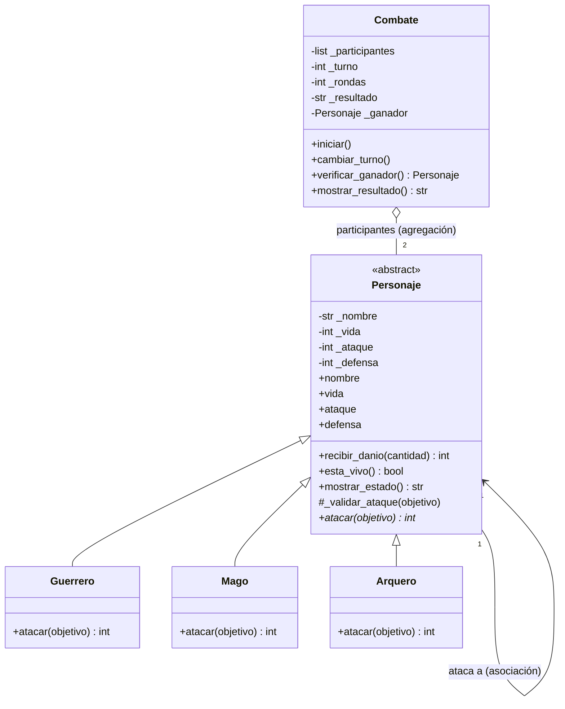

# Guardians of the Ancient Kingdom

Sistema de combate por turnos en Python, desarrollado con Programación Orientada a Objetos.

## 1. Descripción

En el reino de Eldoria existen tres órdenes de guardianes: **Guerreros, Magos y Arqueros**. Todos tienen nombre, vida, ataque y defensa, pero cada uno ataca de forma distinta. El programa resuelve el problema de enfrentar a dos guardianes y decidir automáticamente quién gana, aplicando las reglas de cada personaje, controlando los turnos, actualizando la vida y terminando el combate cuando corresponde (victoria, empate técnico o empate por límite de rondas).

## 2. Estructura

```text
Guardians-of-the-Ancient-Kingdom/
├── personajes.py   # Definición de las clases (no ejecuta nada al importarse)
├── main.py         # Creación de objetos, demostración y pruebas (Pytest)
└── README.md       # Documentación
```

- **`personajes.py`**: contiene `Personaje`, `Guerrero`, `Mago`, `Arquero`, `Combate` y la excepción `AtaqueInvalidoError`.
- **`main.py`**: importa las clases, crea personajes, ejecuta ataques y combates y demuestra las validaciones. Con `python main.py` muestra los 12 casos obligatorios; con `pytest main.py` ejecuta las pruebas automatizadas.
- **`README.md`**: este documento.

## 3. Clases y responsabilidades

| Clase | Responsabilidad |
|---|---|
| `Personaje` (abstracta) | Guarda y valida nombre, vida, ataque y defensa. Implementa lo común: `recibir_danio()`, `esta_vivo()`, `mostrar_estado()` y las validaciones previas a un ataque. Declara `atacar()` como abstracto. |
| `Guerrero` | Implementa `atacar()` con **Golpe poderoso**: ataque × 1.20 menos la defensa del objetivo. |
| `Mago` | Implementa `atacar()` con **Hechizo penetrante**: su ataque completo ignora la defensa. |
| `Arquero` | Implementa `atacar()` con **Disparo crítico**: si su ataque supera la defensa, el daño base se duplica. |
| `Combate` | Administra el enfrentamiento: lleva el turno, ejecuta los ataques, detecta al ganador y decide los empates. No conoce los detalles de cada personaje. |

## 4. Relaciones entre clases

- **Herencia (es un):** `Guerrero`, `Mago` y `Arquero` *son* un `Personaje`. Se usó para no repetir los atributos y métodos comunes en tres clases.
- **Asociación:** cuando un personaje ataca, interactúa con otro a través de métodos: `atacante.atacar(objetivo)` llama a `objetivo.recibir_danio(...)`. Ninguno es dueño del otro; solo colaboran.
- **Agregación (tiene):** un `Combate` *tiene* dos participantes, pero esos personajes se crean fuera del combate (en `main.py`) y existen aunque el combate termine. Por eso `Combate.__init__` los recibe como parámetros en vez de crearlos.

## 5. Conceptos de POO aplicados

- **Abstracción:** `Personaje` modela lo esencial de un guardián y declara `atacar()` sin decir cómo se hace (`@abstractmethod`). No se puede instanciar directamente (hay un test que lo comprueba).
- **Encapsulamiento:** los atributos son privados (`_vida`, `_ataque`, ...) y se acceden por propiedades (`@property` y setters) que validan los datos. Así es imposible crear un personaje con vida 150 o nombre vacío, ni modificarlo después con valores inválidos.
- **Herencia:** las tres subclases reutilizan el constructor, los getters/setters, `recibir_danio()`, `esta_vivo()` y `mostrar_estado()` de `Personaje`.
- **Polimorfismo:** en `Combate.iniciar()` se ejecuta `atacante.atacar(objetivo)` sin preguntar si es Guerrero, Mago o Arquero; cada objeto responde con su propia fórmula. El test `test_polimorfismo_en_combate` enfrenta las 9 combinaciones posibles.

## 6. Lógica del combate

**Cálculo del daño** (siempre se redondea hacia abajo y nunca es negativo):

| Tipo | Fórmula |
|---|---|
| Guerrero | `max(0, ataque × 1.20 − defensa)` (se calcula con enteros: `ataque * 6 // 5`, para evitar errores de decimales) |
| Mago | `ataque` |
| Arquero | `(ataque − defensa) × 2` si `ataque > defensa`; si no, `0` |

`recibir_danio()` descuenta el daño ya calculado (sin volver a restar defensa), evita que la vida baje de 0 y devuelve el **daño efectivo** realmente recibido. Por eso, en el ejemplo del enunciado, el último golpe de Gandalf contra Arthas (que tenía 20 de vida) se registra como 20 y no como 40.

**Turnos:** el primer personaje pasado a `Combate` ataca primero. Una **ronda** son dos turnos (uno por personaje). Después de cada ataque se muestra el estado de ambos y se llama a `verificar_ganador()`; si nadie ha caído, `cambiar_turno()` alterna al atacante. Un personaje derrotado no vuelve a atacar porque el combate termina en ese momento. El combate acaba por:

1. **Victoria:** la vida de un participante llega a 0.
2. **Empate técnico:** una ronda completa donde ninguno causó daño.
3. **Empate por límite:** se completan 50 rondas sin ganador.

## 7. Ejecución

Requisitos: Python 3.8 o superior (Pytest solo es necesario para las pruebas automatizadas).

```bash
git clone https://github.com/<tu-usuario>/Guardians-of-the-Ancient-Kingdom.git
cd Guardians-of-the-Ancient-Kingdom

# Demostración: combate de ejemplo + 12 casos de prueba
python main.py

# Pruebas automatizadas
pip install pytest
pytest main.py -v
```

## 8. Pruebas

### Casos obligatorios (`python main.py`)

| # | Caso | Resultado |
|---|---|---|
| 1 | Creación de Guerrero, Mago y Arquero | Se crean correctamente |
| 2 | Vida 101 y vida -5 | `ValueError` |
| 3 | Nombre vacío | `ValueError` |
| 4 | Ataque 0 y defensa -1 | `ValueError` |
| 5 | Guerrero: 30 de ataque vs 10 de defensa | Daño **26** |
| 6 | Mago: 40 de ataque vs 20 de defensa | Daño **40** (ignora defensa) |
| 7 | Arquero: 35 de ataque vs 15 de defensa | Daño **40** (crítico) |
| 8 | 50 de daño a un personaje con 20 de vida | Vida final 0, daño efectivo 20 |
| 9 | Derrotado ataca / es atacado / objetivo inválido | `AtaqueInvalidoError` / `TypeError` |
| 10-11 | Combate Arthas vs Gandalf | Gana **Gandalf** con 2 de vida (coincide con la tabla del enunciado) |
| 12 | Dos personajes que no pueden hacerse daño | **Empate técnico** tras la ronda 1 |

### Reto extra 2: Pytest

[Pytest](https://docs.pytest.org) es una librería de Python que busca funciones llamadas `test_*`, las ejecuta y reporta cuáles pasan o fallan. Permite verificar las reglas del programa de forma repetible, sin revisar los mensajes a ojo. Las pruebas están dentro de `main.py` (permitido por el enunciado) y cubren: creación válida, rechazo de valores incorrectos, daño de cada clase, vida nunca negativa, derrotado que no ataca y resultado de los combates (victoria, empate técnico y empate a 50 rondas).

Ejecución: `pytest main.py -v`

```text
============================= test session starts ==============================
collected 33 items

main.py::test_creacion_correcta_de_los_tres_tipos PASSED                 [  3%]
main.py::test_personaje_es_abstracto PASSED                              [  6%]
main.py::test_rechaza_vida_fuera_de_rango[101] PASSED                    [  9%]
main.py::test_rechaza_vida_fuera_de_rango[-1] PASSED                     [ 12%]
main.py::test_rechaza_vida_fuera_de_rango[1000] PASSED                   [ 15%]
main.py::test_rechaza_vida_de_tipo_incorrecto PASSED                     [ 18%]
main.py::test_rechaza_nombre_vacio[] PASSED                              [ 21%]
main.py::test_rechaza_nombre_vacio[   ] PASSED                           [ 24%]
main.py::test_rechaza_nombre_no_texto PASSED                             [ 27%]
main.py::test_rechaza_ataque_no_positivo[0] PASSED                       [ 30%]
main.py::test_rechaza_ataque_no_positivo[-5] PASSED                      [ 33%]
main.py::test_rechaza_defensa_negativa[-1] PASSED                        [ 36%]
main.py::test_rechaza_defensa_negativa[-20] PASSED                       [ 39%]
main.py::test_defensa_cero_es_valida PASSED                              [ 42%]
main.py::test_setters_validan_igual_que_el_constructor PASSED            [ 45%]
main.py::test_guerrero_golpe_poderoso PASSED                             [ 48%]
main.py::test_guerrero_redondea_hacia_abajo_y_no_hace_danio_negativo PASSED [ 51%]
main.py::test_mago_ignora_defensa PASSED                                 [ 54%]
main.py::test_arquero_disparo_critico PASSED                             [ 57%]
main.py::test_arquero_sin_critico_si_no_supera_defensa PASSED            [ 60%]
main.py::test_vida_nunca_negativa PASSED                                 [ 63%]
main.py::test_recibir_danio_rechaza_cantidad_negativa PASSED             [ 66%]
main.py::test_recibir_danio_no_descuenta_defensa_otra_vez PASSED         [ 69%]
main.py::test_derrotado_no_puede_atacar PASSED                           [ 72%]
main.py::test_no_se_puede_atacar_a_un_derrotado PASSED                   [ 75%]
main.py::test_objetivo_invalido PASSED                                   [ 78%]
main.py::test_combate_completo_del_enunciado PASSED                      [ 81%]
main.py::test_combate_gana_el_primero_si_derrota_antes PASSED            [ 84%]
main.py::test_combate_valida_participantes PASSED                        [ 87%]
main.py::test_cambiar_turno_y_verificar_ganador PASSED                   [ 90%]
main.py::test_empate_tecnico_sin_dano PASSED                             [ 93%]
main.py::test_empate_por_limite_de_50_rondas PASSED                      [ 96%]
main.py::test_polimorfismo_en_combate PASSED                             [100%]

============================== 33 passed in 0.05s ==============================
```

---

## Reto extra 1: Diagrama de clases UML

Un **diagrama de clases UML** es un plano del programa: muestra las clases, sus atributos y métodos, y cómo se relacionan. Sirve para entender y comunicar la arquitectura antes (o después) de programar. Este diagrama está escrito en Mermaid, que GitHub renderiza automáticamente.



**Explicación del diagrama:**

- `Personaje` aparece como `<<abstract>>` y su método `atacar()` lleva `*` (abstracto). Contiene los atributos privados (`-`) y los métodos comunes.
- Las flechas con triángulo vacío (`<|--`) son **herencia**: las tres subclases extienden a `Personaje` y solo redefinen `atacar()`.
- La flecha simple (`-->`) de `Personaje` a `Personaje` es la **asociación**: un personaje usa a otro cuando lo ataca.
- El rombo vacío (`o--`) en `Combate` es la **agregación**: el combate agrupa a dos personajes que existen por separado.

---

## Reto de abstracción

**¿Por qué `atacar()` debe ser abstracto, pero `recibir_danio()` puede estar implementado en la clase base?**

**Responsabilidad de `Personaje`.** La clase `Personaje` representa lo que *cualquier* guardián de Eldoria es y puede hacer, sin importar su orden. Su trabajo es definir el contrato común (todos atacan, reciben daño, pueden estar vivos o derrotados) e implementar lo que es idéntico para todos.

**Lo que comparten todos los personajes.** Recibir daño funciona igual para un Guerrero, un Mago o un Arquero: la vida baja, nunca queda por debajo de cero y se informa cuánto daño se recibió realmente. Si la vida de Arthas es 20 y recibe 50, queda en 0 y devuelve 20, exactamente igual que le pasaría a Gandalf o a Legolas. Como la regla es la misma, tiene sentido escribirla una sola vez en `Personaje.recibir_danio()` y que las tres subclases la hereden. Duplicarla en cada clase sería repetir código y, peor, abriría la puerta a que una de las copias tuviera un error (por ejemplo, permitir vida negativa).

**Lo que cambia entre ellos.** Atacar, en cambio, es justamente lo que diferencia a cada orden:

- `Guerrero`: `max(0, ataque × 1.2 − defensa)`.
- `Mago`: `ataque`, ignorando la defensa.
- `Arquero`: `(ataque − defensa) × 2` solo si el ataque supera la defensa.

Con los mismos números, un ataque de 40 contra una defensa de 20 produce resultados muy distintos según quién lo lance. No existe una fórmula "general" que `Personaje` pueda implementar sin favorecer a un tipo, así que no tiene sentido darle un cuerpo. Declarar `atacar()` como `@abstractmethod` expresa que *todo personaje sabe atacar, pero la clase base no sabe cómo*, y obliga a cada subclase a definirlo: si alguien crea un nuevo guardián y olvida `atacar()`, Python lanza un error al instanciarlo en vez de fallar silenciosamente en medio de un combate.

**Relación con la abstracción, la herencia y el polimorfismo.**

- *Abstracción:* `Personaje` se queda solo con lo esencial y deja los detalles variables a las subclases.
- *Herencia:* `recibir_danio()`, `esta_vivo()`, `mostrar_estado()` y los atributos validados se reutilizan sin copiarlos.
- *Polimorfismo:* como todos los personajes garantizan tener `atacar()`, `Combate.iniciar()` puede llamar `atacante.atacar(objetivo)` sin saber qué tipo es cada uno, y cada objeto aplica su propia habilidad. Por eso se podría añadir un nuevo guardián (por ejemplo, un `Paladin`) escribiendo solo su clase con su `atacar()`, sin tocar ni una línea de `Combate`.

Además, `atacar()` y `recibir_danio()` cooperan sin mezclar responsabilidades: `atacar()` calcula *cuánto* daño se causa (según la habilidad del atacante) y `recibir_danio()` decide *cómo afecta* eso a la vida del que lo recibe (con las reglas comunes).
